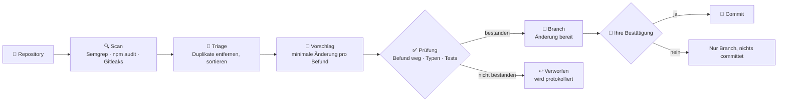

# 🛡️ Sicherheitsfixer

**Findet Sicherheitslücken in TypeScript-Projekten und schlägt geprüfte Korrekturen vor. Ohne Ihre Zustimmung wird nichts committet.**


---

## Inhalt

- [Warum es das gibt](#warum-es-das-gibt)
- [So funktioniert es](#so-funktioniert-es)
- [Funktionen](#funktionen)
- [Installation](#installation)
- [Verwendung](#verwendung)
- [Sicherheitsgrenzen](#sicherheitsgrenzen)
- [Konfiguration](#konfiguration)
- [Testlauf mit OWASP Juice Shop](#testlauf-mit-owasp-juice-shop)
- [Entwicklung](#entwicklung)
- [Roadmap](#roadmap)
- [Lizenz](#lizenz)

---

## Warum es das gibt

Die meisten Sicherheitslücken entstehen nicht aus Unwissen, sondern aus Routine: ein fehlender Rechtecheck, eine veraltete Abhängigkeit, ein Schlüssel, der versehentlich ins Repository rutscht.

Sicherheitsfixer übernimmt diese Routine. Er sammelt Befunde, bereinigt sie, schlägt minimale Korrekturen vor und prüft jede davon, bevor Sie sie sehen.

## So funktioniert es



## Funktionen

| | Funktion | Beschreibung |
|---|---|---|
| 🔍 | **Mehrere Scanner** | Semgrep für Code, `npm audit` für Abhängigkeiten, Gitleaks für geheime Schlüssel |
| 🧹 | **Triage** | Entfernt doppelte Befunde und sortiert nach Schweregrad |
| 📊 | **Bericht auf Deutsch** | Übersichtlicher Markdown-Bericht mit Zusammenfassung |
| 🤖 | **Minimale Korrekturen** | Das Modell ändert nur die betroffene Datei und nur die nötige Stelle |
| ✅ | **Prüfung vor Anzeige** | Befund muss verschwinden, TypeScript muss kompilieren, Tests müssen laufen |
| 🌿 | **Eigener Branch** | Änderungen landen nie direkt im Hauptzweig |
| 📜 | **Protokoll** | Jede Entscheidung wird mit Zeitstempel gespeichert |

## Installation

**Voraussetzungen**

- Node.js 20 oder neuer
- Git
- [Semgrep](https://semgrep.dev) (`pipx install semgrep`)
- [Gitleaks](https://github.com/gitleaks/gitleaks) (optional, aber empfohlen)
- Ein API-Schlüssel für `fix`

```bash
git clone https://github.com/lamin-16/security-fixer.git
cd security-fixer
npm install
npm run build
npm test
```

> **Termux:** Semgrep lässt sich über pip installieren. Gitleaks ist für Android nicht fertig gebaut und muss manuell kompiliert werden. Fehlt ein Werkzeug, überspringt das Tool es und meldet einen Hinweis.

## Verwendung

**1. Scannen und Bericht erstellen**

```bash
node dist/cli.js scan ./mein-projekt --bericht bericht.md
```

**2. Korrekturen vorschlagen und prüfen lassen**

```bash
export ANTHROPIC_API_KEY=ihr-schluessel
node dist/cli.js fix ./mein-projekt --max 5
```

Das Ergebnis liegt in einem neuen Branch `sicherheitsfixer/...`. Prüfen Sie die Änderungen mit `git diff`.

**3. Committen (mit Bestätigung)**

```bash
node dist/cli.js fix ./mein-projekt --commit
```

## Agenten-Modus

Mit `--agenten` prüft ein zweiter, unabhängiger Agent jede Korrektur, bevor sie angewendet wird.

```bash
node dist/cli.js fix ./mein-projekt --agenten
```

Die Pipeline besteht aus drei Stufen:

1. **Fixer** schlägt eine minimale Korrektur vor.
2. **Reviewer** prüft sie kritisch und lehnt sie im Zweifel ab. Ein Fehler oder eine unklare Antwort gilt als Ablehnung.
3. **Verifier** führt die deterministische Prüfung aus: Befund-Zählung, TypeScript und Tests. Das letzte Wort hat immer der Verifier.

Jede Entscheidung aller drei Stufen steht im Protokoll.

## Sicherheitsgrenzen

Dieses Tool ist bewusst eingeschränkt. Diese Grenzen sind Teil der Konstruktion und nicht optional.

- **Nur lokale Git-Repositories.** Ohne `.git` startet das Tool nicht. Arbeitet man mit fremden, ungespeicherten Änderungen, verweigert es die Korrektur.
- **Keine Angriffe.** Das Tool sendet keine Anfragen an laufende Systeme. Es analysiert Quellcode und Abhängigkeiten, mehr nicht.
- **Keine Ausführung von Exploits.** Die Tests dienen nur der Prüfung der Korrektur.
- **Eng begrenzte Änderungen.** Korrigiert werden nur Semgrep-Befunde mit Datei. Pro Befund wird eine einzelne Datei geändert.
- **Geschützte Pfade.** `.git`, `node_modules` und `.env*` werden nie angefasst.
- **Keine automatischen Commits.** Ohne `--commit` und ausdrückliches „ja“ bleibt alles im Branch.
- **Datenschutz.** Der Inhalt der betroffenen Datei wird an die Anthropic-API gesendet. Verarbeiten Sie keine Dateien mit Geheimnissen, Kundendaten oder vertraulichem Code, bevor Sie geprüft haben, ob das zulässig ist.
- **Keine Garantie.** Auch geprüfte Korrekturen müssen Sie lesen, bevor Sie sie übernehmen.

## Konfiguration

| Option / Variable | Standard | Wirkung |
|---|---|---|
| `ANTHROPIC_API_KEY` | – | API-Schlüssel, erforderlich für `fix` |
| `--min` | `low` | Mindestschwere: `critical`, `high`, `medium`, `low`, `info` |
| `--max` | `5` | Maximale Anzahl Korrekturen pro Lauf |
| `--modell` | `claude-sonnet-5-5` | Modell für Korrekturvorschläge |
| `--semgrep-config` | `p/typescript` | Semgrep-Regelsatz |
| `--bericht` | – | Bericht in Datei schreiben statt auf der Konsole ausgeben |
| `--commit` | aus | Nach Prüfung und Bestätigung committen |

Das Protokoll liegt unter `~/.sicherheitsfixer/audit.jsonl` und damit außerhalb jedes Repositories.

## Testlauf mit OWASP Juice Shop

Juice Shop enthält absichtlich Schwachstellen und ist ein geeignetes Testziel. Eine Anleitung finden Sie in [`docs/juice-shop.md`](docs/juice-shop.md).

```bash
git clone https://github.com/juice-shop/juice-shop.git
node dist/cli.js scan ./juice-shop --bericht bericht.md
```

## Entwicklung

```bash
npm run dev -- scan ./beispiel    # direkt aus dem Quellcode starten
npm run build                     # nach dist/ kompilieren
npm test                          # Tests ausführen
```

Projektstruktur:

```
src/
├── cli.ts          Einstiegspunkt und Ablauf
├── scanners.ts     Aufruf von Semgrep, npm audit, Gitleaks
├── sarif.ts        Einlesen von SARIF-Berichten
├── triage.ts       Duplikate, Filter, Sortierung
├── fixer.ts        Korrekturvorschlag über die Anthropic-API
├── verify.ts       Prüfung nach jeder Korrektur
├── guard.ts        Sicherheitsprüfungen für Pfade und Repositories
├── git.ts          Branch und Commit
├── report.ts       Bericht auf Deutsch
└── audit.ts        Protokoll
```

## Roadmap

- [ ] Zeilenunabhängige Befund-Erkennung, damit Verschiebungen nach einer Korrektur sauber verfolgt werden
- [ ] Unterstützung für Python-Projekte
- [ ] HTML-Bericht mit Filtern
- [x] Testlauf ohne Änderungen (`--trocken`)
- [ ] Eigene Regeln als Datei einbinden

## Mitwirken

Beiträge sind willkommen. Bitte öffnen Sie zuerst ein Issue, wenn Sie etwas Größeres ändern möchten. Sicherheitslücken in diesem Tool melden Sie bitte privat über die GitHub-Funktion „Security Advisory“, nicht als öffentliches Issue.

## Lizenz

[MIT](LICENSE)

## Changelog

### 0.3.0
- Agenten-Modus mit `--agenten`: unabhängiger Reviewer prüft jede Korrektur.
- Fail-closed: Fehler oder unklare Antworten gelten als Ablehnung.

### 0.2.0
- Mehrere Vorkommen derselben Regel in einer Datei können jetzt nacheinander korrigiert werden.
- Neuer Trockenlauf mit `--trocken`.
- GitHub-Actions-Workflow für Build und Tests.
- Klon-Link in der Dokumentation korrigiert.
